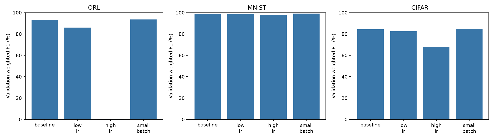
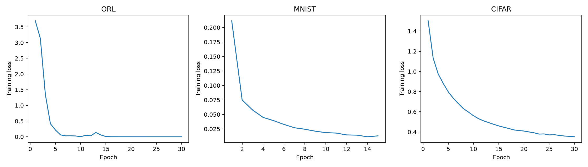

# Stage 3 evaluation and hyperparameter tuning

All metrics below are percentages. Precision, recall, and F1 use support-weighted averaging.

## Experiment protocol

Each dataset uses its existing baseline CNN architecture, Adam, cross-entropy, seed 1, and a fixed stratified 80/20 split of the supplied training set. The four configurations vary learning rate or batch size one at a time. Training lasts 15 epochs for MNIST and 30 for ORL/CIFAR. The configuration with the highest validation weighted F1 is selected; exact ties favor the earlier configuration (baseline first). A fresh model is then trained on the entire supplied training set and evaluated on the supplied test set. ORL uses CPU; MNIST and CIFAR use MPS.

## Validation comparison

| Dataset | Configuration | LR | Batch | Accuracy | Precision | Recall | F1 |
|---|---|---:|---:|---:|---:|---:|---:|
| ORL | baseline | 0.001 | 16 | 94.44 | 93.98 | 94.44 | 93.33 |
| ORL | low_lr | 0.0001 | 16 | 88.89 | 86.11 | 88.89 | 86.02 |
| ORL | high_lr | 0.01 | 16 | 1.39 | 0.02 | 1.39 | 0.04 |
| ORL | small_batch | 0.001 | 8 | 94.44 | 94.91 | 94.44 | 93.61 |
| MNIST | baseline | 0.001 | 64 | 98.78 | 98.78 | 98.78 | 98.77 |
| MNIST | low_lr | 0.0001 | 64 | 98.57 | 98.57 | 98.57 | 98.57 |
| MNIST | high_lr | 0.01 | 64 | 98.17 | 98.19 | 98.17 | 98.17 |
| MNIST | small_batch | 0.001 | 32 | 99.04 | 99.04 | 99.04 | 99.04 |
| CIFAR | baseline | 0.001 | 64 | 84.27 | 84.92 | 84.27 | 84.36 |
| CIFAR | low_lr | 0.0001 | 64 | 82.50 | 82.69 | 82.50 | 82.42 |
| CIFAR | high_lr | 0.01 | 64 | 68.11 | 69.70 | 68.11 | 67.85 |
| CIFAR | small_batch | 0.001 | 32 | 84.63 | 84.82 | 84.63 | 84.58 |

## Final held-out test results

| Dataset | Selected setting | Accuracy | Precision | Recall | F1 |
|---|---|---:|---:|---:|---:|
| ORL | small_batch | 97.50 | 96.25 | 97.50 | 96.67 |
| MNIST | small_batch | 99.11 | 99.11 | 99.11 | 99.11 |
| CIFAR | small_batch | 84.87 | 85.06 | 84.87 | 84.85 |

## Interpretation and limitations

Selection uses validation F1, not final test performance. These are single-seed results on one validation split; small differences do not establish a statistically reliable advantage. ORL has only 72 validation images and 40 test images, making its percentages particularly sensitive to individual errors. The epoch budget is fixed, so a lower learning rate may need more epochs than this study allows. GPU arithmetic can cause small differences on reruns. Weighted averages can hide weak classes; the saved per-class reports and confusion matrices provide additional detail.

The architecture label `baseline` in each run describes the fixed CNN architecture, not necessarily the default learning rate or batch size. See the `experiment` names and recorded settings.

## Figures

